# Lab 3 — The Command Line: Shell, Pipes and Text Filters

Gafenco Victor · FAF-241 · Operating Systems · Patricia Reițman · UTM · 2026

## Purpose and evidence

Explore Bash command lookup, expansion, quoting, streams, job control and pipelines, then build a repeatable log report on openSUSE Tumbleweed.

Figures show saved terminal output, with plain text in [evidence/](evidence/). [Predictions](evidence/predictions.txt) precede the expansion experiments. Commands use `LC_ALL=C` and Bash without personal startup files.

## Preparation and data

Linux exercises use `~/os-lab3`.

Generate the shared data exactly as specified:

```bash
mkdir -p ~/os-lab3 && cd ~/os-lab3
for i in $(seq 1 500); do
  echo "2026-10-05 10:$(printf %02d $((i % 60))) user$((i % 7)) $([ $((i % 5)) -eq 0 ] && echo FAIL || echo OK) /page$((i % 4))"
done > access.log
head -3 access.log
wc -l access.log
```

The first rows are `10:01 user1 OK /page1`, `10:02 user2 OK /page2`, and `10:03 user3 OK /page3`, all dated 2026-10-05. The observed count is **500 lines**. This is synthetic data; it does not describe real web traffic. The timestamps cycle every 60 rows, so “last” in Q6 means file order, not a chronological sort.

## Part 1 — Navigation, history and help

- Typing `ls /usr/sh` and pressing Tab completed the unique prefix to `/usr/share/`; the second Tab did not produce a list of competing matches in this run. `cd /et<Tab><Enter>` became `cd /etc/`, confirmed by `pwd`. Completion depends on which names actually exist.
- After `echo history_marker_lab3`, `pwd`, and `date +%F`, Ctrl+R located the first command. Enter accepted and executed it. [Raw history evidence](evidence/1-history.raw) records the actual Readline interaction.
- `cd` and `echo` are Bash built-ins; `ls` is the external `/usr/bin/ls`. An external `echo` also exists, but the built-in wins normal lookup. `cd` must affect the current shell process: a child's directory change cannot update its parent.
- The captured PATH contains **5 entries** in the clean-shell check. `which ls` resolves `/usr/bin/ls`. The check uses `/home/victor/.local/bin:/usr/local/bin:/usr/bin:/bin:/usr/sbin`; other shell environments may have different entries.
- `nosuchprog` returns **127**, the shell's command-not-found status.
- `ls -t` sorts by modification time, newest first. The first attempt at `man ls` exposed missing manual pages. After installing the local documentation and setting MANPATH, `man ls` showed `-t` and `man -k "list directory"` found `ls`, `dir` and `vdir` ([verification](evidence/1-help-final.txt)); `ls --help` and Bash's `help cd` provide separate help mechanisms. `man -k` searches the manual index; its results depend on installed pages and the index.

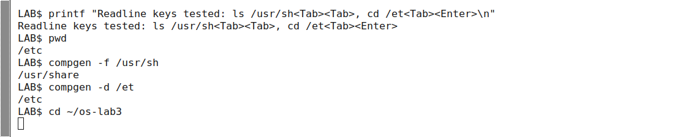
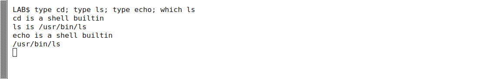
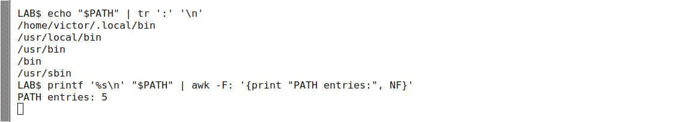


## Part 2 — Expansion and quoting

The initial files are `a.c`, `b.c`, `file1.txt`, `file2.txt`, `notes.txt`, and `alfa beta.txt`. Three `log` files are created by the final command. The predictions below correspond to the clean first experiment; later runs can retain those generated files.

| Command | Prediction before running | Observed result | Explanation |
| --- | --- | --- | --- |
| `echo *.c` | `a.c b.c` | `a.c b.c` | Bash expands matching pathnames. |
| `echo file?.txt` | `file1.txt file2.txt` | Same | `?` matches exactly one character. |
| `echo [a-b]*` | `a.c alfa beta.txt b.c` | Same | The space inside the matched filename remains part of one argument. |
| `echo *.xyz` | `*.xyz` | `*.xyz` | No match: default Bash leaves the pattern literal. |
| `ls alfa beta.txt` | Two missing-path errors | Errors for `alfa` and `beta.txt` | Unquoted whitespace separates words. |
| `ls "alfa beta.txt"` | One existing filename, possibly displayed with quotes | `'alfa beta.txt'` | Quotes preserve one argument; `ls` adds display quotes in a terminal. |
| `echo '$HOME' "$HOME" \$HOME` | `$HOME /home/victor $HOME` | Same | Only the double-quoted variable expands. |
| `echo {1..5}; echo $((7 * 6))` | `1 2 3 4 5`, then `42` | Same | Brace expansion and arithmetic expansion. |
| `echo "today is $(date +%A), I am $(whoami)"` | Runtime weekday and login name | `today is Monday, I am victor` | Command substitution executes both commands. |
| `touch log{1..3}.txt && ls log*` | `log1.txt log2.txt log3.txt` | Same names, terminal column spacing | Brace expansion creates names; globbing finds them. |

Bash, not `echo`, produces the filenames. Two fixes for the spaced filename are `ls "alfa beta.txt"` and `ls alfa\ beta.txt`. Single quotes preserve all enclosed characters literally. Double quotes preserve spaces while still allowing parameter, command and arithmetic expansion; backslash escapes selected characters. The single quotes displayed by GNU `ls` are presentation, not characters stored in the filename.

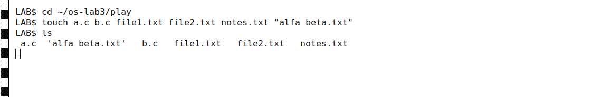
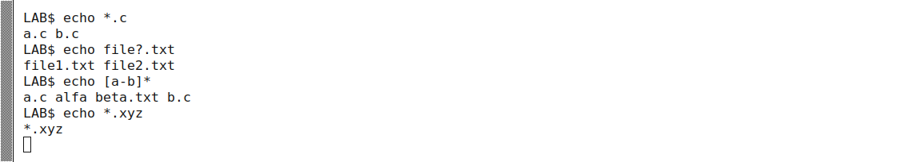
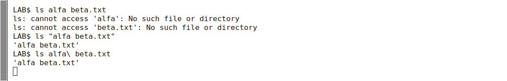
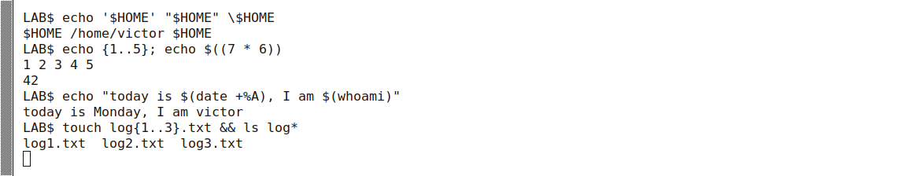

## Part 3 — Streams, sequencing and jobs

`ls /etc /nope > out.txt 2> err.txt` sends the directory listing to `out.txt` and the `/nope` error to `err.txt`. The exact listing length is machine-dependent. Combining them with `> all.txt 2>&1` stores both streams in `all.txt`; `tail -2` need not show the error because the diagnostic can precede the buffered listing.

Redirections are processed **left to right**. `> all.txt 2>&1` first redirects descriptor 1, then duplicates its new destination onto descriptor 2. `2>&1 > all.txt` first duplicates the terminal destination onto descriptor 2, then redirects only descriptor 1. The latter displays the error in the terminal.

`>` truncates or creates a file, whereas `>>` appends. The two writes to `notes.md` produce `first` followed by `second`. `wc -l < access.log` prints `500`: `wc` reads standard input and receives no filename argument. `wc -l access.log` also prints the filename.

`;` runs the next command regardless of the previous status. `&&` runs its right-hand command only after success. `||` runs its right-hand command only after failure. Thus the suppressed `ls /nope` error is followed by `failed with code 2`; this is GNU `ls`'s error status, distinct from command-not-found status 127.

`sleep 100 &` launches a background job. `jobs` lists it and `kill %1` signals job 1. An immediate `jobs` can still say Running because signal delivery and job reaping are asynchronous; after a short wait it is reported Terminated and no running job remains.

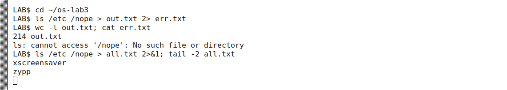
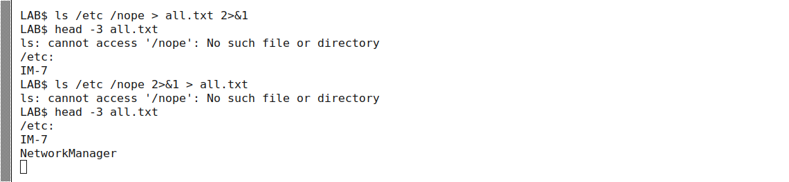
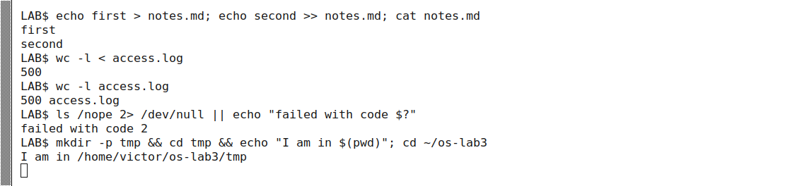
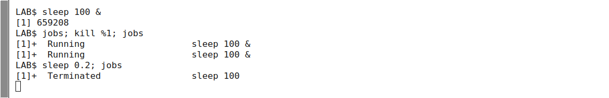

## Part 4 — Questions and runnable one-liners

[oneliners.sh](oneliners.sh) contains one command line per question and runs with `bash oneliners.sh` in `~/os-lab3`. Field-aware `awk` expressions avoid accidentally matching a word in the wrong column. Q4 keeps **all ties** rather than taking only the first row.

| Question | Measured answer |
| --- | --- |
| Q1. Failed requests | **100** |
| Q2. Distinct pages | **4**: `/page0`, `/page1`, `/page2`, `/page3` |
| Q3. Requests per page | **125 each**, total 500 |
| Q4. Most failures | **user3 and user5, 15 each** |
| Q5. user3 totals | **72 requests, 15 failures** |
| Q6. Last three failures, time and user | `10:10 user0`; `10:15 user5`; `10:20 user3` |
| Q7. Configured account shells | **2** `/bin/bash`; **32** `/usr/sbin/nologin` |
| Q8. Listing line counts | **213** versus **214** in the recorded run |

Q7 counts accounts in `/etc/passwd`, including service accounts configured with `nologin`; it does not count logged-in people. For Q8, the prediction was a difference of one. Piped `ls` emits one entry per line; `ls -l` adds a `total` header. This explains the observed difference for this `/etc`. Aliases, unusual filenames with embedded newlines, or directory changes during execution can complicate a universal claim.

The per-user failure counts are `14, 14, 14, 15, 14, 15, 14` for user0 through user6. They sum to **100**, agreeing with Q1. Page counts sum to **500**. [bonus.sh](bonus.sh) uses `grep -E` to select failures whose minute ends in zero, prints the matching rows, and counts **50**. Every tenth index has a minute ending in zero and is also divisible by five.

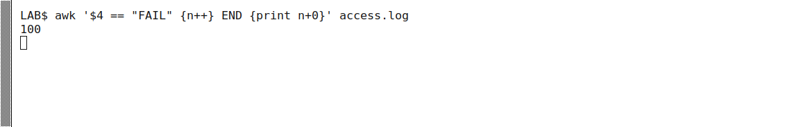
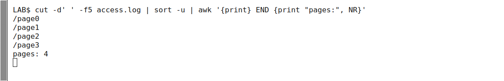
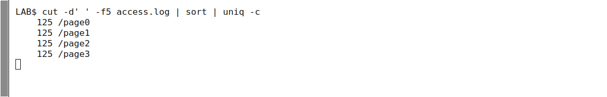
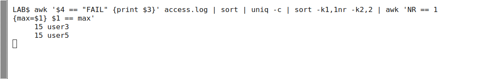
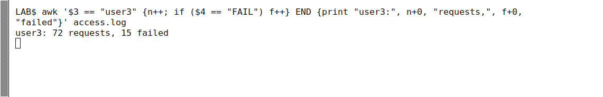
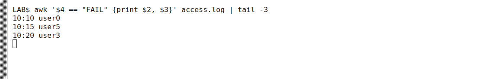
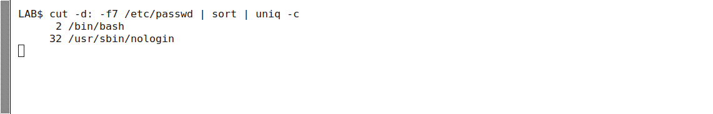

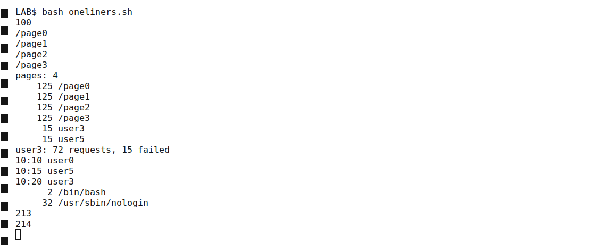

## Part 5 — report.sh

[report.sh](report.sh) validates its argument and input readability, prints the total and failure count, and loops over `user{0..6}`. Its output on the generated data is:

```text
500 requests, 100 failed
user0: 14 failures
user1: 14 failures
user2: 14 failures
user3: 15 failures
user4: 14 failures
user5: 15 failures
user6: 14 failures
```

A nonexistent file prints `no such readable file: nope.log` to standard error and exits **1**. Missing or extra arguments print usage and exit **1**. Tests also cover an empty file, zero failures and a filename containing spaces; successful empty counts are explicitly zero.

`#!/bin/bash` tells the kernel which interpreter to use for direct execution. Without executable permission, `./report.sh` fails with Permission denied (normally status 126); `bash report.sh` reads it explicitly and does not require the execute bit. `./` names a path in the current directory, which is not implicitly searched through PATH. Errors belong on descriptor 2 so they do not contaminate normal output; nonzero status lets callers detect failure.

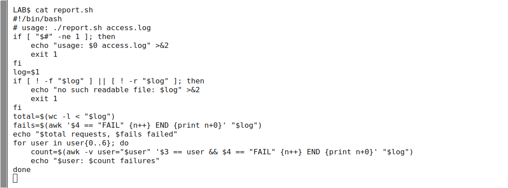
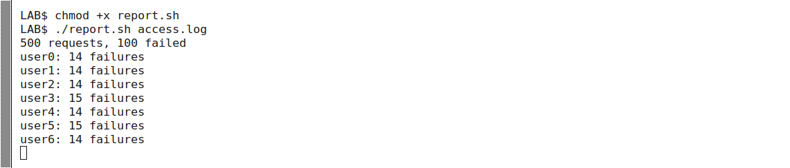
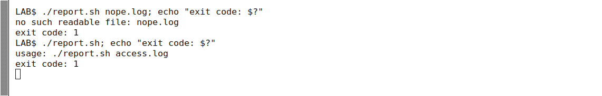

The optional cron exercise is not part of the required submission; no claim of scheduled execution is made here. A suitable full-path entry is shown for reproducibility:

```cron
* * * * * /home/victor/os-lab3/report.sh /home/victor/os-lab3/access.log >> /home/victor/os-lab3/report.log 2>&1
```

If trying the bonus, retain the existing crontab, add only this entry, wait for two executions and remove only this entry afterwards. Do not use `crontab -r` to remove unrelated jobs.

## Conclusions

Shell expansion occurs before the program receives arguments. Quoting controls the boundary between words, while redirection changes file-descriptor destinations before execution. Pipelines make simple tools useful for structured questions, but correct field selection and tied maxima matter. Exit statuses and separate error output make the same operations reliable in scripts.
