# Lab 4 — The xv6 Shell from the Outside

Gafenco Victor · FAF-241 · Operating Systems · Patricia Reițman · UTM · 2026

## Purpose and environment

Compare Bash with xv6's shell, make the Lab 2 sleep program work on the course revision, inspect argument boundaries with a small C program, and connect observations to `user/sh.c`.

The host is **openSUSE Tumbleweed**, replacing the Ubuntu VM used in the Lab 1–2 screenshots. The course revision is **06aad25c735fd3159bdfae5680be4eab7b1668b2**, checked out on branch `lab` in `~/xv6-riscv`. The compiler is **riscv64-suse-linux-gcc 14.4.0** and QEMU is **11.1.2**. The preparation build and boot check succeeded.

Figures show saved terminal output, with plain text retained under [evidence/](evidence/).

To boot the completed tree:

```bash
cd ~/xv6-riscv
make qemu
# Exit: Ctrl+A, then X.
```

The repository includes [user/sleep.c](user/sleep.c), [user/args.c](user/args.c), [args_linux.c](args_linux.c), the complete [Makefile](Makefile), and a focused [Makefile.patch](Makefile.patch). The Makefile adds the openSUSE compiler-prefix branch and the two UPROGS entries. Existing Lab 1–2 files are retained.

## Part 1 — sleep on the current tree

`grep -n "pause\|sleep" user/user.h` reports `25:int pause(int);`. The Lab 2 source already called `pause`, so its logic could be reused rather than changed back to the obsolete system-call name. The executable is still named `sleep`.

The program requires exactly one ticks argument. It calls `pause(atoi(argv[1]))`, then exits with status 0. Missing or extra arguments print `usage: sleep <ticks>` on descriptor 2 and exit with status 1. The program follows the handout's scope: it does not reject every malformed or negative numeric string.

`$U/_sleep\` and `$U/_args\` are separate tab-indented UPROGS entries. The blank line after the last continued UPROGS entry is preserved. The tree builds using `make kernel/kernel fs.img` and boots with `make qemu CPUS=1` in the evidence run.

| xv6 command | Actual output |
| --- | --- |
| `sleep 20` | Returns to the prompt without a diagnostic. |
| `sleep` | `usage: sleep <ticks>` |
| `sleep 10 20` | `usage: sleep <ticks>` |

The transcript demonstrates successful execution and argument-count handling, not an independently measured exact sleep duration or displayed exit status.

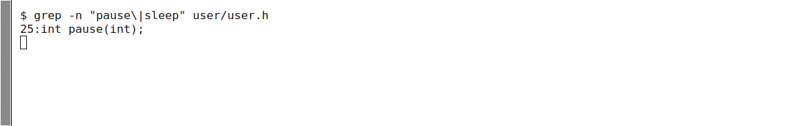
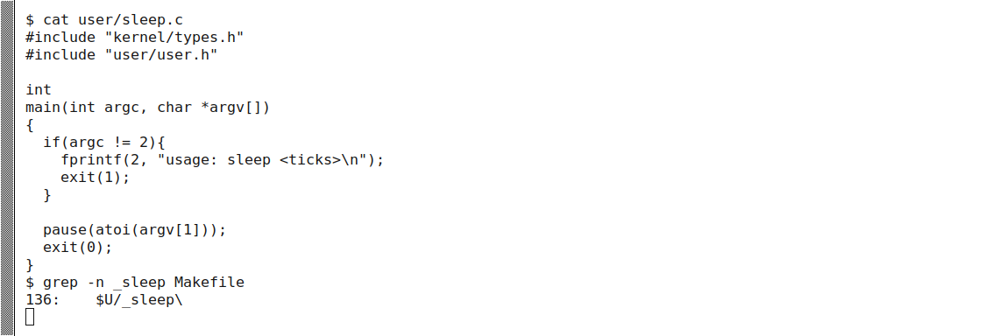
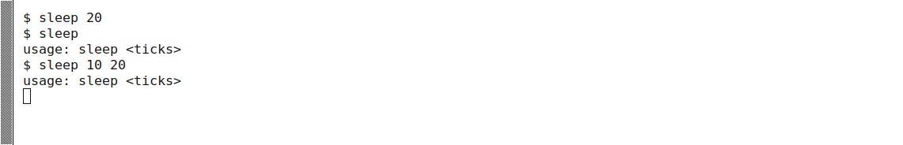

## Part 2 — Bash versus xv6

Bash was run without personal startup files in `~/shtest`, with a file named README. The Linux C source is also present for the argument experiment, so the actual glob listing contains it. xv6 starts in its root directory, which contains the installed user programs. Counts and file sizes in xv6 `ls` output reflect this built image.

| Command / action | Bash observation | xv6 observation | Reason |
| --- | --- | --- | --- |
| `echo hello > f ; cat < f` | `hello` | `hello` | Both implement redirection and sequences. |
| `ls \| grep READ` | `README` | `README 2 2 2441` with padded columns | Both implement pipes; their `ls` output formats differ. |
| `(echo a; echo b) \| wc` | `2 2 4` with padding | `2 2 4` | Both support grouping, sequencing and pipes. |
| `echo one ; echo two` | Two lines: one, two | Same | Both sequence commands. |
| `echo bg &` | Background job/PID notification and `bg` | `bg`, with no Bash-style job notification | Both can launch a background process; prompt/output order can race. |
| `ls *` | Lists matching entries (README, args_linux.c, f in the initial run) | `ls: cannot open *` | xv6 passes the star literally. |
| `echo $HOME` | `/home/victor` | `$HOME` | xv6 does not expand variables. |
| `echo "a b"` | `a b` | `"a b"`, including the quotes | xv6 has no quote-aware word parsing. |
| `mkdir d ; cd d ; ls ..` | Changes into d and lists the parent | `exec cd failed`, followed by root listing | xv6 recognizes `cd` only before parsing, when it begins the whole input line. |
| Up arrow, Tab, Ctrl+R | History navigation, filename completion and history search | Raw key bytes are echoed; no matching editing operation | xv6 lacks Bash/Readline's editing layer. |

**Important correction to the handout's combined `cd` example:** the literal line above does not change directory in xv6. After testing it exactly, I entered `cd d` on its own. This succeeded; then `ls ..` printed `exec ls failed`. `/ls ..` succeeded because `/ls` names the executable in the root directory. `../ls ..` would also name it from `/d`. A standalone `cd /` restored the initial directory.

Shared features are command execution, input/output redirection, pipes, sequences, grouping, background execution, and a basic standalone `cd`. Bash additionally supplies PATH lookup, variable expansion, globbing, meaningful quotes, history/completion, conditional operators and job-control commands. `cd` support in xv6 is narrower than Bash's support inside compound commands.

For everyday work, history and completion would be the most noticeable omissions. Among these missing conveniences, a fixed search fallback for executable names would be a relatively small first extension: after a failed relative `exec`, try a known program directory, preserving explicit pathnames. General globbing or correct quote parsing would need more substantial parsing and expansion work. This is a design judgment, not an implemented change.

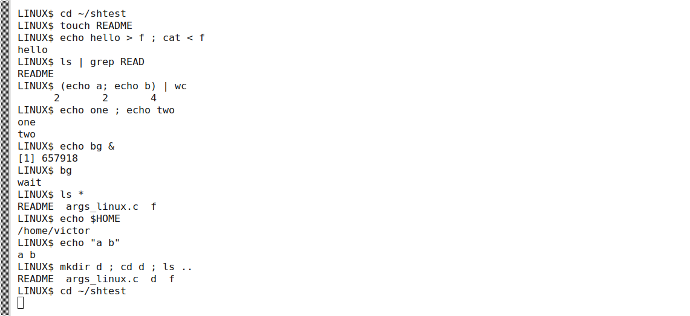
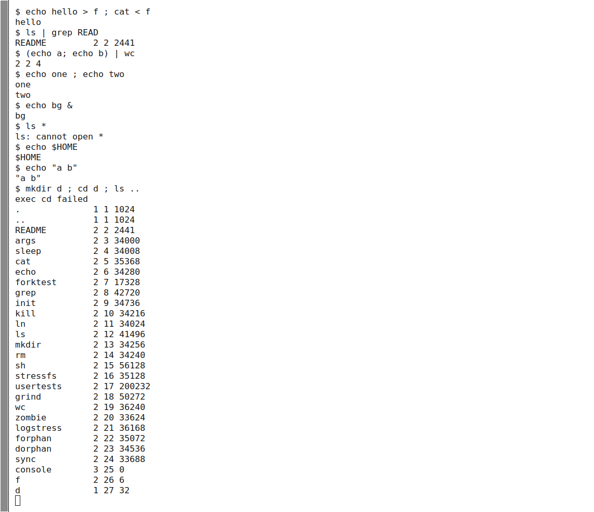
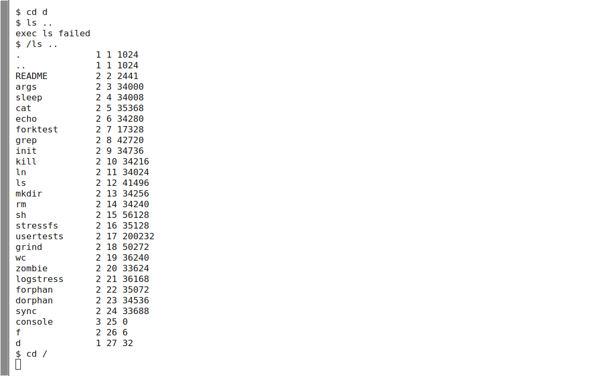

## Part 3 — Who expands the arguments?

Both programs print `argc` and every `argv` element. The xv6 version includes `kernel/types.h` and `user/user.h`, then ends with `exit(0)`. The Linux version includes `<stdio.h>` and returns 0. Linux compilation used the stronger check:

```bash
gcc -Wall -Wextra -Werror -o args args_linux.c
```

For the requested `args *.c "x y"` comparison, Bash is run as `./args` in a directory with `args_linux.c`:

```text
LINUX$ ./args *.c "x y"
argc = 3
argv[0] = [./args]
argv[1] = [args_linux.c]
argv[2] = [x y]
```

```text
$ args *.c "x y"
argc = 4
argv[0] = [args]
argv[1] = [*.c]
argv[2] = ["x]
argv[3] = [y"]
```

Bash therefore passed **two operands** (`argc = 3` including the program name), while xv6 passed **three operands** (`argc = 4`). In Bash the number would change if more `.c` files were present. The xv6 root image contains executables, not the host's `user/*.c` files, but its parser would still pass the star literally even if matching names existed.

| Input after program name | Bash | xv6 |
| --- | --- | --- |
| `one              two         three` | argc 4; three words | argc 4; same words |
| `*.c "x y"` | argc 3; filename plus `x y` | argc 4; `*.c`, `"x`, `y"` |
| `$HOME` | argc 2; `/home/victor` | argc 2; literal `$HOME` |
| `'single quoted'` | argc 2; `single quoted` | argc 3; `'single`, `quoted'` |

The **shell** expands patterns and variables and removes syntactic quotes before the program begins. The kernel's `exec` interface transports the supplied argument vector; the printing program simply reveals it. Repeated unquoted spaces are separators in both shells, so they do not create empty arguments.

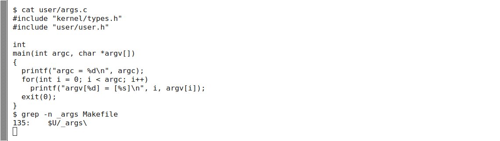
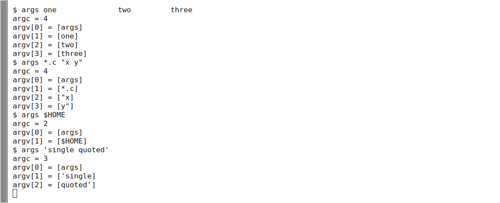
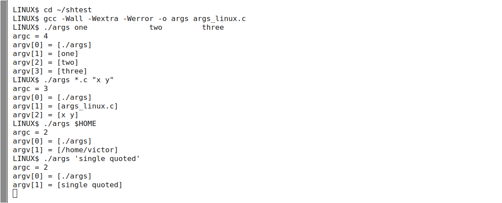

## Part 4 — Reading user/sh.c

The pinned file has **499 lines**. Its command-node definitions are at lines 8–12:

| Kind | Syntax that creates it | Execution behaviour |
| --- | --- | --- |
| `EXEC` | An ordinary command word; no special operator | Calls `exec` with parsed argv. |
| `REDIR` | `<`, `>`, or parsed `>>` | Closes and opens the selected descriptor, then runs the nested command. |
| `PIPE` | `\|` | Creates a pipe, forks both sides, and connects descriptors with `dup`. |
| `LIST` | `;` | Forks and waits for the left side, then runs the right side. |
| `BACK` | `&` | Forks the nested command without waiting for it in that node. |

Parentheses group commands through `parseblock`; they do not introduce a sixth node type. The parser recognizes `>>`, but this simple implementation lacks Bash's general append semantics: the `+` case opens with `O_WRONLY | O_CREATE` without an append flag or seek. It should not be assumed equivalent to Bash just because the token is recognized.

`cd` is handled in `main`, **lines 166–170**, before the `fork1`/`parsecmd` path. Its `chdir` call must run in the persistent shell process. That placement both explains why standalone `cd` works and why an embedded `cd` in a semicolon list is attempted as an external executable.

`gettoken` skips whitespace and recognizes shell operator characters. It contains no pathname-globbing or variable-substitution logic, and quote marks are ordinary word characters. Searching for `*` finds many C pointer declarations/dereferences; those are not shell glob implementations. Searching for `$` finds the printed prompt, not variable expansion. Reading the surrounding code is necessary to interpret those matches.

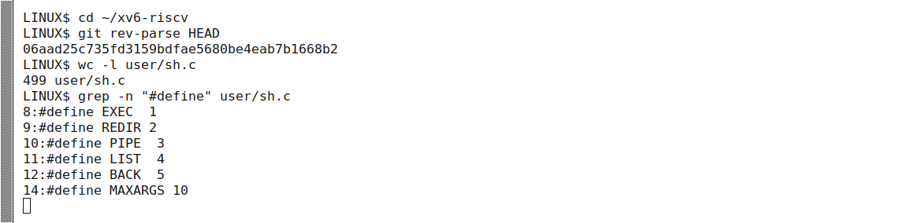
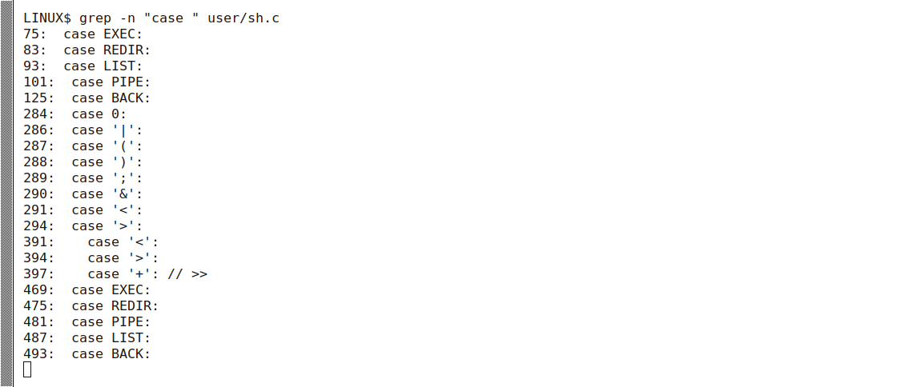
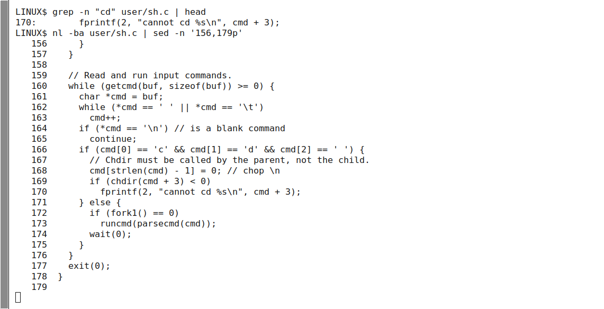

## Validation and conclusions

- The preparation check built and booted xv6, ran `ls`, and reached **All set**.
- The completed tree builds with both custom programs registered.
- QEMU runs covered all prescribed shell command lines, three sleep calls, four argv comparisons, the standalone cd/PATH workaround and raw editing keys.
- Linux `args` compiles cleanly with `-Wall -Wextra -Werror`.
- QEMU was exited through Ctrl+A, X, releasing its filesystem image.

The shell provides policy and interpretation on top of kernel primitives. The same printing program receives different argument vectors because its caller constructs them differently. xv6 demonstrates the core mechanisms compactly, while Bash adds conveniences and more general syntax. Reading the special `cd` path explains an apparent inconsistency in the handout without changing the teaching shell.
